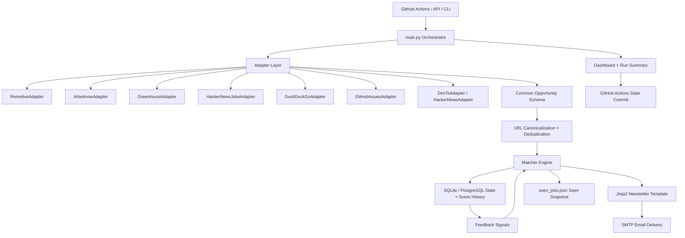

<div align="center">

# JobHunt-Auto

### Career and Opportunity Intelligence Automation Platform

[](https://www.python.org/)
[](https://github.com/meryemgcl/jobhunt-auto/actions)
[](./pyproject.toml)
[](./LICENSE)

**JobHunt-Auto**, yazılım ve bilişim odaklı kariyer fırsatlarını farklı kaynaklardan toplayan, aday profiline göre deterministik olarak puanlayan, tekrarları eleyen ve düzenli HTML e-posta raporu üreten otomasyon sistemidir.

</div>

---

## Current Status

Bu sürüm, üretim otomasyonunun uygulama ve kalite kapılarını içerir. Canlı GitHub Actions çalıştırması için PostgreSQL ve SMTP secrets'larının repository ayarlarına eklenmesi gerekir:

- Deterministik ana motor: `main.py`
- Adapter tabanlı veri toplama mimarisi
- Canonical URL temizleme ve deduplication
- Yapılandırılmış `seen_jobs.json` hafızası
- Yerel kullanımda SQLite; GitHub Actions üretim çalıştırmalarında kalıcı PostgreSQL state'i
- Kullanıcı feedback loop altyapısı: `uygun`, `alakasız`, `basvurdum`
- Jinja2 tabanlı güvenli HTML e-posta şablonu
- `run_id` tabanlı yapılandırılmış loglama
- GitHub Actions concurrency kilidi ve kalite kapıları
- Docker, Docker Compose ve runtime healthcheck
- Legacy CrewAI/prototip kodlarının aktif sistemden ayrılması

Aktif mimari LLM veya CrewAI çalışma zamanına bağlı değildir. Eski CrewAI denemeleri `legacy/` altında korunur, fakat production akışının parçası değildir.

---

## Core Capabilities

**Opportunity collection**

- Remotive, Arbeitnow, 12 Greenhouse kariyer panosu ve Hacker News Hiring üzerinden global yazılım işleri
- DuckDuckGo araması üzerinden bootcamp ve AR-GE keşif sonuçları (doğrulanmış iş ilanı olarak sınıflandırılmaz)
- Kaynak tarihi bulunan iş ilanlarında varsayılan 30 günlük tazelik sınırı; tarihi bilinmeyen sonuçlar bugünün tarihiymiş gibi gösterilmez
- GitHub good first issue radarı
- Dev.to ve Hacker News teknoloji haberleri
- Güncel arama sonuçlarıyla bootcamp ve AR-GE çağrıları; podcast ve yarışmalar için doğrulama notlu kaynak dizinleri

**Matching and filtering**

- Teknoloji, rol seviyesi ve lokasyon ağırlıklarıyla deterministik skor
- Yerleşik negatif filtreler: senior, sales, marketing, muhasebe vb.
- `config.py::EXCLUDED_COMPANIES` — kullanıcı tanımlı şirket kara listesi (0 puan)
- `config.py::EXCLUDED_KEYWORDS` — kullanıcı tanımlı kelime kara listesi (0 puan)
- Profil yetenekleriyle ek skor katkısı
- Kullanıcı feedback'inden üretilen keyword bazlı küçük ağırlık düzeltmeleri
- Puan >= 85 olan ilanlar e-postada "YÜKSEK EŞLEŞME" etiketiyle öne çıkar

**State and observability**

- `seen_jobs.json`: GitHub Actions uyumlu, geriye dönük hafıza snapshot’ı
- `jobhunt.db`: fırsatlar, skor geçmişi, feedback, run summary ve source run kayıtları
- `DASHBOARD.md` ve `applications.json`: atomik transaction ile güncellenen dashboard state
- `RUN_SUMMARY.md`: son çalışma özeti ve kaynak alarm görünümü

**Notification**

- Jinja2 template tabanlı HTML rapor
- Tüm dış kaynaklı alanlarda HTML autoescape
- URL scheme doğrulaması ile unsafe link engelleme
- Kaynak güven puanı ve tazelik metriği

---

## Architecture



---

## Repository Structure

```text
jobhunt-auto/
├── .github/
│   ├── workflows/job_hunt.yml          # Scheduled CI/CD automation
│   ├── ISSUE_TEMPLATE/                 # Bug report & feature request templates
│   └── PULL_REQUEST_TEMPLATE.md
├── scripts/
│   ├── generate_static_dashboard.py   # Database dashboard report generator
│   └── migrate_sqlite_to_postgres.py  # One-time local state migration
├── services/
│   ├── adapters/                       # Source adapters with shared schema
│   ├── database.py                     # SQLite/PostgreSQL state, feedback and score history
│   ├── feedback.py                     # Feedback ingestion and matcher signals
│   ├── http_client.py                  # Session, timeout, retry and User-Agent
│   ├── job_collector.py                # Multi-source collection facade
│   ├── logging_config.py               # run_id structured logging
│   ├── matcher.py                      # Scoring and exclusion rules (inc. blacklists)
│   ├── memory.py                       # Structured seen_jobs.json compatibility layer
│   ├── models.py                       # Opportunity model and freshness scoring
│   ├── observability.py                # Source counts, alerts and run summaries
│   ├── state_io.py                     # Atomic file writes and transactions
│   ├── tracker.py                      # Dashboard/application state writer
│   └── notification_and_meta/
│       ├── notifier.py                 # SMTP delivery and Jinja2 template rendering
│       └── templates/newsletter.html.j2
├── tests/                              # Unit and smoke tests
├── legacy/                             # Archived CrewAI/prototype layer
├── ajan-filosu/                        # Parallel task orchestration system
├── api.py                              # FastAPI trigger, health and feedback API
├── main.py                             # Deterministic orchestration engine
├── config.py                           # Feature flags, search prompts, blacklists
├── healthcheck.py                      # Runtime/container healthcheck
├── Dockerfile
├── docker-compose.yml
├── pyproject.toml
├── CHANGELOG.md
├── SECURITY.md
├── seen_jobs.json                      # Versioned memory snapshot
├── jobhunt.db                          # Local-only SQLite state (ignored by Git)
├── DASHBOARD.md                        # Generated career dashboard snapshot
└── applications.json                   # Generated machine-readable dashboard state
```

---

## Installation

### 1. Clone

```bash
git clone https://github.com/meryemgcl/jobhunt-auto.git
cd jobhunt-auto
```

### 2. Create a virtual environment

Windows (Python 3.11–3.13):

```powershell
.\scripts\setup_local.ps1
.\.venv\Scripts\activate
```

Linux/macOS:

```bash
python -m venv .venv
source .venv/bin/activate
python -m pip install --upgrade pip
pip install -r requirements-dev.txt -r requirements-api.txt
```

For the local engine, install only `requirements-dev.txt`. `requirements-legacy.txt` and `legacy/` are archived prototypes, are not part of the supported runtime, and must not be installed for this no-generative-AI setup.
For PostgreSQL-backed local or Docker runs, also install `requirements-postgres.txt`.

### 3. Configure environment variables

The Windows setup script creates `.env` from `.env.example` only if it does not already exist. It never overwrites an existing local configuration. A live SMTP account is not required for preview runs.

Create `.env` manually if needed:

```bash
cp .env.example .env
```

Required for email delivery:

```ini
SMTP_USER=your_email@gmail.com
SMTP_PASS=your_app_password
USER_EMAIL_TO=recipient@example.com
```

`SMTP_HOST` defaults to `smtp.gmail.com` and `SMTP_PORT` defaults to `587`; set them when using another provider.

Recommended production settings:

```ini
JOBHUNT_API_TOKEN=replace_with_a_long_random_token
JOBHUNT_DB_PATH=jobhunt.db
JOBHUNT_LOG_LEVEL=INFO
JOBHUNT_HTTP_TIMEOUT=10
JOBHUNT_MAX_JOB_AGE_DAYS=30
JOBHUNT_USER_AGENT=JobHunt-Auto/1.0 (+https://github.com/meryemgcl/jobhunt-auto)
DATABASE_URL=
JOBHUNT_DATABASE_SSLMODE=require
GITHUB_TOKEN=
N8N_WEBHOOK_URL=
```

Never commit `.env`, `jobhunt.db`, or container volume data.
For GitHub Actions production, configure a managed PostgreSQL `DATABASE_URL` secret; the workflow fails fast if it is missing. The local engine uses SQLite when `DATABASE_URL` is unset.

Before the first production run, migrate an existing local database to an empty managed PostgreSQL database. Add its connection string to local `.env`, then run:

```bash
python scripts/migrate_sqlite_to_postgres.py --source jobhunt.db
python scripts/migrate_sqlite_to_postgres.py --source jobhunt.db --apply
```

Back up the local SQLite file before migrating. The first command is a dry run. The migration retains opportunity, feedback, score, and run history records, normalizes legacy URL keys, merges duplicate canonical URLs, and refuses to write to a non-empty target. Add the same value as the GitHub `DATABASE_URL` secret only after migration succeeds. Keep the connection string private.

---

## Running the System

The active application path is deterministic Python code. It does not call generative AI services, LLM APIs, or AI SDKs. There is no AI/CV extraction adapter; candidate settings are read from `profile.yaml`. If you add `eligible_countries` to that profile, explicit source country restrictions will be enforced; without it, the system will not assume your work authorization. Do not add AI credentials to `.env`; `legacy/` is archived and is not installed by local setup.

Start with a safe preview. This fetches current listings and writes `data/newsletter_preview.html`; it does not send email or modify the database, seen-job memory, dashboard, or run summaries. CLI runs default to preview mode:

```bash
python main.py --dry-run
```

Open `data/newsletter_preview.html` in a browser and check the source links, dates, and matches. To actually persist state and send email, opt in explicitly with:

```bash
python main.py --send
```

Only use `--send` after setting valid SMTP configuration and verifying the preview.

Run the healthcheck:

```bash
python healthcheck.py
```

Run the API:

```bash
uvicorn api:app --host 0.0.0.0 --port 8000
```

Trigger a run:

```bash
curl -X POST http://localhost:8000/trigger-engine \
  -H "X-Jobhunt-Token: $JOBHUNT_API_TOKEN"
```

Submit feedback:

```bash
curl -X POST http://localhost:8000/feedback \
  -H "Content-Type: application/json" \
  -H "X-Jobhunt-Token: $JOBHUNT_API_TOKEN" \
  -d '{"url":"https://example.com/job","feedback":"uygun","note":"Good match for backend internship"}'
```

Allowed feedback values:

- `uygun`: boosts matching signals for similar terms and marks the opportunity as fit
- `alakasız`: excludes the exact opportunity and penalizes similar terms
- `basvurdum`: marks the opportunity as applied and avoids repeated reporting

---

## Docker Deployment

Build and run a no-send local preview:

```bash
docker compose up --build jobhunt-auto
```

The default container command is safe preview mode and writes the rendered HTML to `data/newsletter_preview.html`. To explicitly persist state and send a newsletter after checking configuration and preview output:

```bash
docker compose run --build --rm jobhunt-auto python main.py --send
```

Run the API service:

```bash
docker compose --profile api up --build jobhunt-api
```

The compose file mounts `./data` to `/app/data` and stores SQLite runtime state at `/app/data/jobhunt.db`. The container healthcheck executes `python healthcheck.py`.

To use PostgreSQL from Docker, set `DATABASE_URL` in `.env`; the image includes the PostgreSQL driver. Use a managed database with TLS for production.
The optional API uses an in-process run lock and is not a durable job queue; the production workflow remains GitHub Actions.

---

## Quality Gates

Run these before every pull request:

```bash
ruff check .
python -m compileall main.py api.py config.py healthcheck.py services legacy tests
python -c "import main; import api; from services.notification_and_meta.notifier import build_html_newsletter; print('smoke ok')"
python healthcheck.py
pytest
```

The GitHub Actions workflow also runs these checks, prevents overlapping scheduled jobs with `concurrency`, then executes the engine and commits versioned runtime snapshots when they change.

---

## GitHub Actions Setup

The default workflow runs every day at 06:00 and 11:00 UTC, corresponding to 09:00 and 14:00 Turkey time.
Job feeds include recent postings from Remotive, Arbeitnow, Hacker News Hiring and the Greenhouse boards listed in `config.py`. Known-dated jobs older than `JOBHUNT_MAX_JOB_AGE_DAYS` (default 30) are excluded; sources that do not provide a publication date remain explicitly marked as unknown. Search results and directory pages are not represented as verified open applications.

Add these repository secrets under **Settings > Secrets and variables > Actions**:

| Secret | Purpose |
|---|---|
| `SMTP_USER` | sender email account |
| `SMTP_PASS` | sender app password |
| `USER_EMAIL_TO` | report recipient |
| `DATABASE_URL` | persistent managed PostgreSQL connection string (required for the scheduled workflow) |
| `JOBHUNT_API_TOKEN` | protects API trigger and feedback endpoints when the optional API is deployed |

Optional values:

| Variable | Purpose |
|---|---|
| `SMTP_HOST` | repository variable for SMTP host (defaults to Gmail) |
| `SMTP_PORT` | repository variable for SMTP port (defaults to 587) |
| `JOBHUNT_LOG_LEVEL` | controls log verbosity |
| `JOBHUNT_DB_PATH` | overrides SQLite database path |

---

## Data Model

State database tables:

- `opportunities`: canonical opportunity records and latest status
- `score_history`: score and match reason snapshots per run
- `feedback`: user feedback events
- `run_summaries`: per-run totals, alarms and delivery status
- `source_runs`: source-level counts and explicit adapter error counts

GitHub Actions uses the same schema on managed PostgreSQL so feedback, score history, email delivery outbox, and run/source records survive runner shutdown. `seen_jobs.json` is also kept as a compact repository snapshot for URL deduplication; the database is authoritative for production history and feedback. Do not commit the database file.

The JSON memory file remains intentionally supported because it is simple to diff and easy for GitHub Actions to persist. Local runs default to SQLite; production workflow runs use PostgreSQL. A rendered newsletter is durably enqueued before scanned opportunities are suppressed. On SMTP failure the pending digest is retried before newer discoveries are committed or queued; those discoveries are rescanned afterward. SMTP cannot guarantee exactly-once delivery if the connection drops after the provider accepts a message, so retries use a stable outbox Message-ID for correlation.

---

## Cross-AI Development Guide

When continuing this project with another AI assistant, keep these rules in the prompt/context:

- Treat `main.py` as the production orchestrator.
- Treat `legacy/` as archived reference code unless explicitly asked to revive it.
- Keep every source collector behind `services/adapters/OpportunityAdapter`.
- Return opportunities through the shared schema in `services/models.py`.
- Always canonicalize URLs before deduplication or persistence.
- Record every scanned opportunity before email delivery so the chosen suppress-after-scan behavior survives email failures.
- Use PostgreSQL for GitHub Actions feedback, score history and run summaries; use SQLite locally and never commit `jobhunt.db`.
- Use `logging`, never `print`, in production modules.
- Preserve `run_id` logging context for every new workflow step.
- Keep external HTML content inside the Jinja2 template with autoescape enabled.
- Add or update tests for matcher rules, adapters, state writes and security behavior.
- Run the full quality gate before committing.

Recommended handoff prompt:

```text
You are working on JobHunt-Auto. The active production path is main.py plus services/.
Legacy CrewAI/prototype files live under legacy/ and are not part of runtime.
Keep adapters behind OpportunityAdapter, use canonical URLs for dedupe, write production runtime state through PostgreSQL (SQLite locally), and atomically update dashboard files.
Before finalizing, run ruff, compileall, import smoke, healthcheck and pytest.
```

---

## Security Notes

- `.env` is ignored and must never be committed.
- `JOBHUNT_API_TOKEN` is required for protected API endpoints; without it they fail closed.
- GitHub Actions requires `DATABASE_URL` so durable feedback and run history are not lost with the ephemeral runner.
- The newsletter renderer autoescapes external fields and rejects non-HTTP(S) links.
- SMTP failures return a failed engine status. By request, scanned opportunities are still persisted and suppressed from later newsletters even when delivery fails; workflow runs visibly fail and require operator review.
- Container runtime state should live in a mounted volume, not in the image.

---

## License

This project is licensed under the [MIT License](./LICENSE).

Maintainer: **Meryem Güçlü**
